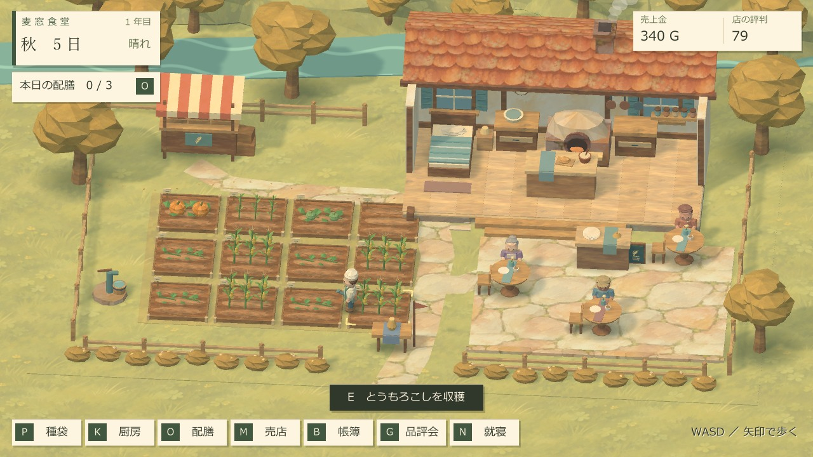

# 麦窓食堂

朝の左手の畑には、もう収穫できる小麦があります。まず厨房を開き、手元の小麦で「窓辺の丸パン」を作ってみてください。最初の手順は「和える」、次は「焼く」。できた料理を配膳すると、次にまく種代を稼げます。

| 場面 | 操作 |
| --- | --- |
| 畑 | WASD／矢印で歩く。Pで種を選び、区画の近くでE。種まき、水やり、収穫を作物の状態に応じて行います。 |
| 厨房 | Kで献立帳を開く。食材が揃った料理を選び、1〜4のキー、または画面のボタンで、指定された工程を順に実行します。針が黄金色の帯に入った瞬間に決めると、仕上がりが良くなります。 |
| 食堂と売店 | Oでお客の注文を確認して配膳。Mで種を買い、収穫物を売り、じょうろ・調理台・客席を強化できます。 |
| 季節の暮らし | Bで帳簿、Gで品評会、Nで就寝。寝ると水をやった作物が成長します。ひとつの季節は7日、1年は28日です。 |

8種類の作物を12区画で育てられます。旬の野菜は成長が早く、乾かさずに育てると上質な食材になります。雨の日は水やりが省けます。手持ちが少なくなったときは翌朝にもらえる種で畑を再開できます。

献立は、春野菜のキッシュ、夏畑のラタトゥイユ、秋の実りのグラタン、冬野菜のポトフなど16品。それぞれに挿絵と調理手順があります。特選の料理や注文の組み合わせを工夫して、四季の品評会の賞印を集めてください。翌年には必要な配膳数と出品数が増えます。

## 手動で調整する

- [Harvest.unity](../Assets/Games/Harvest/Harvest.unity) をUnityで開き、**潮彩作品集 → 麦窓食堂のデータ編集** を選びます。作物・レシピ・季節を選び、値を変えて「記入内容を検証して保存」を押します。作物と料理は「複製して追加」から増やせます。
- 材料は作物ID、季節の注文は料理IDを参照します。既存セーブを引き継ぐため、公開済みのIDは保ち、新しい項目には新しいIDを付けてください。材料や手順を変更した料理が調理の途中なら、次回起動時に予約していた材料を品質別に返します。保存先は [HarvestCatalog.json](../Assets/Games/Harvest/Resources/Harvest/HarvestCatalog.json) です。
- 個別の料理絵を差し替えるには、`Assets/Games/Harvest/Resources/Harvest/Dishes/` に料理IDと同名のPNGを置いてください。次回の再生時に読み込まれます。[HarvestFarm.cs](../Assets/Games/Harvest/HarvestFarm.cs) で成長、品質、調理、売上と品評会のルールを変更できます。
