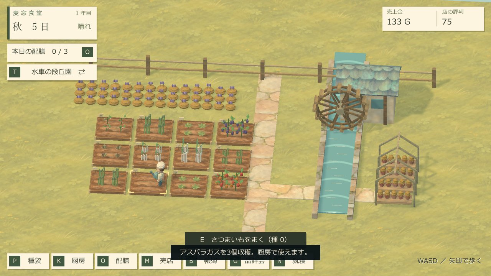

# D農業ゲーム

麦窓食堂

前庭と水車の段丘園で野菜を育て、その収穫で小さな食堂を営みます。春のキッシュから冬のポトフまで、畑の旬を献立に取り入れて注文を仕上げましょう。

**[ブラウザーで遊ぶ](https://kaxic.github.io/shiosai-wheat-window/)** ・ [A〜Fのゲーム一覧](https://kaxic.github.io/shiosai-game-library/#D)

[実際のプレイ映像を見る](https://kaxic.github.io/shiosai-wheat-window/media/demo.mp4)

## 最初にすること

厨房の献立帳を開き、手元の小麦で「窓辺の丸パン」を選びましょう。「和える」「焼く」の順に針を止めます。焼けたパンをお客に配膳したら、売上で次にまく種を買えます。

## 遊びの流れ

種をまいて水をやり、眠ると作物が育ちます。段丘園には偶数日の朝に水が入るので、前庭と作付けを分けるのも手です。収穫後はそのまま売るか、厨房でひと手間加えるかを選べます。

## 目指すもの

二つの畑の計24区画で16種類の作物を育て、32品の献立に挑みましょう。上質な材料と調理の腕で特選料理を仕上げて四季の品評会へ。翌年は配膳や出品の目標も上がります。

[遊び方と手動で拡張する方法](Guides/Harvest.md)

## Unityで開く

Unity Hubでこのフォルダーを追加し、Unity 6000.3.28f1で `Assets/Games/Harvest/Harvest.unity` を開いて再生します。

Web版は Web Build Support を追加し、Unity の **Shiosai → Build browser game** から再ビルドできます。出力先は `docs` です。

[拡張版の内容](更新内容.md) ・ [Windows版をダウンロード](https://github.com/kaxic/shiosai-wheat-window/releases/latest)
